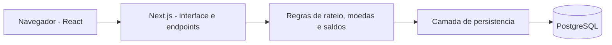

# Split&Go

MVP para organizar despesas de grupos, calcular saldos individuais e sugerir um plano de acerto entre participantes.

## Status

Projeto em planejamento. A aplicacao ainda nao foi implementada. A proposta inicial usa Next.js, TypeScript e PostgreSQL; versoes e instrucoes de execucao serao registradas com a primeira implementacao.

## Arquitetura proposta

Uma aplicacao fullstack evita manter dois projetos e dois deployments no MVP. Next.js atende a interface React e os endpoints no mesmo projeto; TypeScript ajuda a explicitar os contratos; PostgreSQL oferece transacoes e integridade entre grupos, participantes, despesas e rateios.

O navegador chama endpoints do servidor. A camada de dominio recebe dados validados e calcula rateios e saldos; a persistencia grava uma despesa e suas partes na mesma transacao. Credenciais do banco ficam somente no servidor.

O desenvolvimento local tera a aplicacao Node.js e um PostgreSQL via Docker Compose. O deploy sera definido e validado depois da implementacao. Filas, cache e servicos separados nao sao necessarios para o volume esperado do MVP.

### Modelo de dados previsto

- `Group`: nome e moeda base.
- `Member`: nome e grupo ao qual pertence.
- `Expense`: grupo, descricao, pagador, moeda, total original, total convertido e taxa de cambio aplicada.
- `ExpenseShare`: participante e valor devido na moeda base; a soma das partes deve corresponder ao total convertido.

O pagador e todos os participantes de uma despesa devem pertencer ao grupo. Um membro referenciado por despesas nao pode ser excluido sem tratamento dos lancamentos existentes. O plano de acerto e uma sugestao calculada; registrar pagamentos efetivos fica fora da primeira entrega.

### Regras financeiras

- Valores monetarios serao inteiros em unidades minimas da moeda, sem calculos financeiros com ponto flutuante binario.
- O primeiro recorte suporta BRL, USD e EUR, todas com duas casas decimais.
- Cada despesa registra a taxa manual usada na conversao para a moeda base. A taxa representa unidades da moeda base por uma unidade da moeda original; despesas na moeda base usam taxa 1.
- A conversao usa aritmetica decimal e arredondamento half-up uma unica vez. O rateio opera sobre o total convertido.
- No rateio igualitario ou percentual, centavos restantes sao distribuidos pelo metodo dos maiores restos, com desempate por identificador estavel do participante. Percentuais sao expressos em pontos-base e devem somar 10.000 (100%).
- Valores fixos sao informados na moeda base e devem somar exatamente o total convertido.
- Saldo individual = total pago na moeda base menos total devido. A soma dos saldos do grupo deve ser zero.

### Plano de acerto

A implementacao inicial separara credores e devedores e combinara os maiores saldos, transferindo o menor valor entre cada par ate zerar todos os saldos. Isso elimina cadeias de dividas e produz no maximo `n - 1` transferencias para `n` participantes com saldo diferente de zero.

Essa estrategia gulosa nao garante o minimo global de transferencias para todos os conjuntos de saldos. O case pede minimizacao; antes de concluir essa tarefa, sera necessario implementar uma busca exata para grupos pequenos ou registrar e justificar uma decisao de escopo que atenda a avaliacao. A tarefa permanece aberta no backlog.

### Casos de borda

| Caso | Tratamento previsto |
| --- | --- |
| R$ 10,00 divididos entre tres pessoas | Distribuir 334, 333 e 333 centavos com desempate estavel. |
| Percentuais diferentes de 100% ou valores fixos inconsistentes | Rejeitar a despesa e mostrar a diferenca antes de salvar. |
| Cotacao ausente, zero ou negativa | Rejeitar despesas estrangeiras ate informar uma taxa valida. |
| Taxa de cambio muda depois do registro | Preservar a taxa da despesa; nao recalcular o historico automaticamente. |
| Grupo sem despesas ou com saldos zerados | Exibir estado vazio ou grupo quitado, sem transferencias de valor zero. |

### Evolucao do produto

1. Convites e contas de usuario: permitir colaboracao segura e uso recorrente dos grupos.
2. Integracao de cotacoes com registro da fonte e data: reduzir digitacao e erros de conversao.
3. Registro de pagamentos e lembretes: acompanhar a quitacao efetiva e reduzir esquecimentos.

## Escopo inicial

- Cadastro de grupos e participantes.
- Registro de despesas com um pagador e varios participantes.
- Rateio igualitario, por percentual ou por valor fixo.
- Registro de moedas e conversao para a moeda base do grupo.
- Extrato individual e calculo dos saldos.
- Plano de acerto com reducao de transferencias.

## Organizacao

O backlog esta em [docs/backlog.md](docs/backlog.md) e nas [issues do repositorio](https://github.com/reisgabriel767-max/split-and-go/issues).

O [quadro Split&Go - MVP](https://github.com/users/reisgabriel767-max/projects/1) usa as colunas Backlog, In Progress, In Review, Testing e Done. O quadro permanece privado por decisao do responsavel; antes da entrega, sera necessario disponibilizar acesso de leitura aos avaliadores conforme os requisitos do case.

Os commits devem ser pequenos e descrever mudancas reais, seguindo Conventional Commits e referenciando as issues relacionadas, por exemplo: `feat: add group creation (#2)` ou `fix: preserve cents when splitting expenses (#3)`.

## Execucao local

Ainda nao existe aplicacao executavel. Os comandos, variaveis de ambiente e servicos locais serao adicionados e testados na etapa de implementacao.
