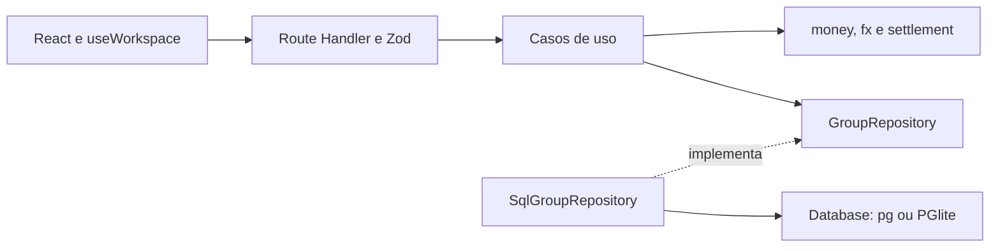

# Arquitetura do Split&Go

Monolito modular fullstack com Next.js 16.4.0, React 19, TypeScript e PostgreSQL. Referencia: 16/10/2026.

## Estrutura

```text
src/
  app/
    page.tsx                       Pagina principal
    api/groups/route.ts            HTTP e composicao das dependencias
  application/
    groups.ts                      Casos de uso e comandos tipados
    group-repository.ts            GroupRepository e GroupTransaction
    errors.ts                      Erros de aplicacao
  infrastructure/
    database.ts                    Adaptadores pg/PGlite e migracoes
    sql-group-repository.ts         SQL, transacoes e bloqueios
  presentation/
    groups-http.ts                 Zod, verificacao de origem e erros HTTP
    groups-client.ts               Cliente fetch
    expense-form.ts                Conversao dos campos para unidades exatas
    group-state.ts                 Remocao consistente do grupo no estado local
  hooks/use-workspace.ts            Estado e coordenacao da interface
  components/
    workspace.tsx                  Composicao visual e formularios
    group-panels.tsx                Saldos, extratos, participantes e acerto
    expense-list.tsx                Tabela responsiva de despesas
    expense-split.tsx               Campos e previas dos rateios
    currency-fields.tsx             Campos de cambio
    settlement-panel.tsx            Plano de transferencias
    delete-group-confirmation.tsx   Confirmacao de exclusao permanente
  lib/
    money.ts                       Centavos, percentuais e rateios
    fx.ts                          Conversao decimal e validacao de taxas
    settlement.ts                  Saldos e minimizacao de transferencias
    types.ts                       Entidades e DTOs
    limits.ts                      Limite de participantes
    db.ts                          Reexportacao compativel da infraestrutura
db/                                Migracoes SQL ordenadas
tests/                             Testes unitarios e de integracao
```

## Dependencias



O dominio e a aplicacao nao importam React, Next.js, HTTP ou drivers de banco. A aplicacao depende do contrato GroupRepository, implementado pela infraestrutura. A rota seleciona SqlGroupRepository, database e randomUUID.

O frontend reutiliza os modulos de dominio para previas, saldos e plano de acerto. Essa dependencia nao substitui a validacao no servidor. Os DTOs compartilham os tipos de `src/lib/types.ts`.

## Dominio

- `money.ts`: valores inteiros em centavos, percentuais em pontos-base, validacao das partes e distribuicao de restos com desempate por identificador estavel.
- `fx.ts`: Decimal.js para conversao, arredondamento half-up uma unica vez antes do rateio e preservacao da taxa historica.
- `settlement.ts`: saldo igual a pago menos devido, plano guloso inicial e programacao dinamica por subconjuntos para comprovar o minimo global em ate 20 saldos nao nulos.
- `limits.ts`: novos grupos e inclusoes limitados a 20 participantes. Grupos legados maiores permanecem acessiveis, com limites de otimalidade documentados no README.

## Casos de uso

`createGroupUseCases(repository, newId)` recebe o repositorio e o gerador de identificadores por injecao explicita.

| Operacao | Responsabilidade |
| --- | --- |
| createGroup | Valida capacidade e nomes distintos; grava grupo e integrantes em transacao. |
| addGroupMember | Bloqueia o grupo, verifica existencia e capacidade e insere o integrante. |
| createExpense | Bloqueia o grupo, converte, rateia, verifica pertencimento e grava despesa e partes. |
| getGroupsSnapshot | Consulta o snapshot pelo contrato de repositorio. |
| deleteGroup | Bloqueia o grupo e remove seus registros vinculados em transacao. IDs inexistentes nao alteram dados. |

Os comandos sao tipados, sem NextRequest ou NextResponse. Zod valida o formato externo na fronteira HTTP. O dominio verifica invariantes monetarias e o caso de uso verifica pertencimento e capacidade.

ApplicationError utiliza os codigos GROUP_NOT_FOUND, INVALID_MEMBERS, MEMBER_LIMIT, DUPLICATE_MEMBER e INVALID_INPUT. SplitError e CurrencyError representam falhas de dominio.

## Persistencia

SqlGroupRepository contem SQL parametrizado e mapeamentos entre comandos e colunas. GroupTransaction expoe operacoes especificas, como lockGroup, countMembers, memberIds e insertExpense, sem expor SQL aos casos de uso.

Database fornece query, exec e transaction. Com DATABASE_URL, o adaptador usa um pool pg de ate cinco conexoes. Sem essa variavel, desenvolvimento utiliza PGlite persistente em `.data/postgres` e testes utilizam memoria. Producao exige DATABASE_URL.

Na escrita, o callback transacional usa a mesma conexao para todas as operacoes. Despesa e partes recebem COMMIT em conjunto; qualquer falha causa ROLLBACK. O codigo SQL 23505 e traduzido para DUPLICATE_MEMBER depois do rollback.

Na exclusao, as despesas sao removidas primeiro, com cascade para as partes, seguidas dos integrantes e do grupo. A ordem preserva as chaves estrangeiras entre participantes, pagadores e rateios. Todas as etapas pertencem a mesma transacao, sem migracao adicional.

`SELECT ... FOR UPDATE` bloqueia a linha do grupo antes de verificar capacidade ou registrar alteracoes. `getSnapshot` define `REPEATABLE READ READ ONLY` antes das quatro consultas, mantendo grupos, integrantes, despesas e partes na mesma visao consistente. As escritas utilizam o isolamento padrao do banco.

As migracoes numeradas em `db/` sao aplicadas em transacao, com controle pela tabela schema_migrations e bloqueio exclusivo durante a inicializacao. `src/lib/db.ts` reexporta a infraestrutura para compatibilidade de imports.

## Fluxo de uma despesa

1. Workspace apresenta os campos e useWorkspace transforma os valores em um comando.
2. saveGroup envia JSON para POST /api/groups.
3. A rota verifica a origem, interpreta o JSON e valida o schema Zod.
4. createExpense abre a transacao e bloqueia o grupo.
5. convertMoney calcula o total convertido; calculateSplit determina as partes.
6. O caso de uso verifica pagador e participantes contra os IDs do grupo.
7. O repositorio insere a despesa e todas as partes na mesma transacao.
8. A resposta HTTP 201 devolve o ID criado.
9. O frontend fecha o modal e solicita um novo snapshot por GET.
10. calculateBalances e planSettlement derivam os saldos e as transferencias.

O modal fecha apos a confirmacao da escrita, antes do refresh. Uma falha de leitura posterior apresenta estado de dados salvos sem lista atualizada. Nao ha chave de idempotencia de escrita.

## Contrato HTTP

- GET /api/groups retorna groups, members, expenses e shares.
- POST /api/groups recebe action group, member ou expense e retorna HTTP 201 com id.
- DELETE /api/groups recebe groupId como UUID e retorna HTTP 204 sem corpo, inclusive para ID inexistente.
- HTTP 400 indica entrada ou regra invalida; 403 indica origem invalida; 409 indica nome duplicado; 503 indica falha inesperada.
- Moeda omitida assume a moeda do grupo; split omitido assume divisao igualitaria.
- Pagador e participantes pertencem ao grupo. O pagador pode ficar fora do rateio.
- Despesas de grupos legados aceitam ate 30 participantes; novos grupos continuam limitados a 20.

## Interface

useWorkspace concentra estado, carga, selecao, formularios, previas, envio e refresh. Workspace compoe a pagina e os formularios. GroupPanels apresenta os paineis, ExpenseList organiza a tabela e os componentes de rateio e cambio exibem campos e previas.

A interface utiliza CSS compartilhado, componentes React e icones Lucide. A navegacao das abas inclui setas, Home e End. Nao ha store global adicional ou biblioteca de formularios. A atualizacao entre navegadores nao e automatica.

## Principios e limites

A separacao aplica responsabilidade unica, inversao de dependencias e contratos orientados as operacoes do dominio. A persistencia pode ser substituida sem alterar os casos de uso. Os testes de aplicacao injetam repositorios de teste e os testes de integracao validam os adaptadores reais.

O projeto utiliza principios de Clean Architecture sem adotar integralmente o padrao. Tipos de leitura sao compartilhados, o hook coordena varias responsabilidades de interface e os formularios permanecem em Workspace. Nao ha conteiner de injecao de dependencias.

Permanecem fora do MVP: autenticacao, autorizacao por conta, idempotencia, paginacao, sincronizacao multiusuario automatica, backup operacional e registro de pagamentos efetivos. A verificacao estatica de imports nao cobre dependencias dinamicas.

## Verificacao

A suite local possui 46 testes, incluindo dominio, aplicacao, HTTP, exclusao, rollback, migracoes, concorrencia e renderizacao estatica. O fluxo compilado e validado por HTTP. A [CI 38937774034](https://github.com/reisgabriel767-max/split-and-go/actions/runs/38937774034) representa a versao anterior de 38 testes, sem exclusao. Resultados e limites estao em [validation.md](validation.md).
